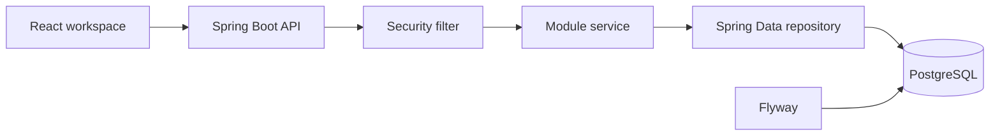

# Architecture

SolarFlow is a modular monolith. One Spring Boot service owns the business rules. The React app is a client of `/api/v1`.

## Backend packages

Each business area is a package: `auth`, `company`, `user`, `customer`, `lead`, `survey`, `quotation`, `project`, `inventory`, `payment`, `warranty`, `service`, `notification`, plus `health`.

Later phases follow Controller, then Service, then Repository. Controllers stay thin. Services own transactions and rules. Repositories own queries. API responses use DTOs, never JPA entities.

Shared code:

- `common.entity` — identity and timestamps
- `common.exception` — one error shape for the API
- `common.tenant` — company checks
- `config` — security and OpenAPI

Financial amounts use `BigDecimal` and `NUMERIC` columns.

## Tenancy

A company is the tenant. Every company-owned row stores `company_id`. Child rows also store `company_id`, and foreign keys use `(id, company_id)` so a lead cannot point at another company's customer.

The company id comes from the authenticated user. The client cannot choose a tenant. `TenantGuards.sameCompany` reports a mismatch as not found, and customer lookup uses the caller's company so another company's id returns 404.

## Authentication

- Access token: signed JWT, 15 minutes, sent as `Authorization: Bearer`, kept in memory
- Refresh token: random secret, only its SHA-256 hash stored, HttpOnly `solarflow_refresh` cookie, path `/api`, SameSite Lax, Secure when `COOKIE_SECURE=true`
- Rotation on refresh. Reuse of a revoked token revokes the family, and that revocation is committed even though the request returns 401
- `POST /api/v1/auth/login`, `/refresh`, and `/logout` are public. Logout-all, change-password, and `/me` require the access token
- CSRF cookie `XSRF-TOKEN`, echoed in `X-XSRF-TOKEN`

Business rules for several modules currently live in the controller that owns the transaction. Auth is the exception: `AuthService` owns the token lifecycle.

## Frontend

`src/app` owns routing, providers, and the shell. `src/components` is the design system. `src/features` owns a module's pages. Shared clients live in `src/lib` and `src/services`.

The dev server proxies `/api` to port 8080 so cookies and the API share the page origin during local work.

## Data flow

