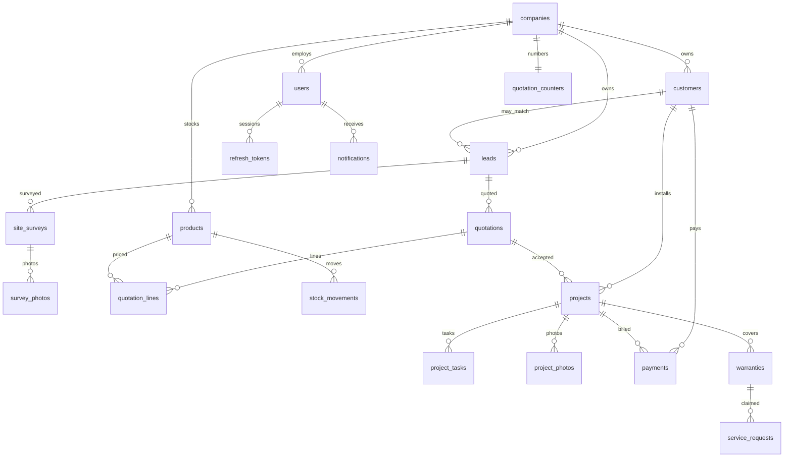

# Database

PostgreSQL 16. Schema changes only through Flyway in `backend/src/main/resources/db/migration`. Hibernate validates the mapping and does not create tables.

`V1__create_schema.sql` creates the business tables. `V2__seed_demo_company.sql` inserts one fictional company, Helios Rooftop Solar in Pune, and its quotation counter. No user is seeded. A password will be introduced with authentication tests in Phase 2.

## Entity relationship

## Tenant rule

Company-owned tables include `company_id`. Where a child references a parent, the foreign key includes `company_id`. Nullable assignees use the same pair, so PostgreSQL checks the user only when an assignee is set, and that user must belong to the same company.

## Money and quantities

Currency and totals are `NUMERIC(14,2)`. Capacities are `NUMERIC(8,2)`. Stock quantities are `NUMERIC(12,2)`. Application code uses `BigDecimal`.

## Indexes

List and pipeline screens filter by company plus status, follow-up date, payment date, warranty end, or notification time. Those pairs are indexed in `V1`.
